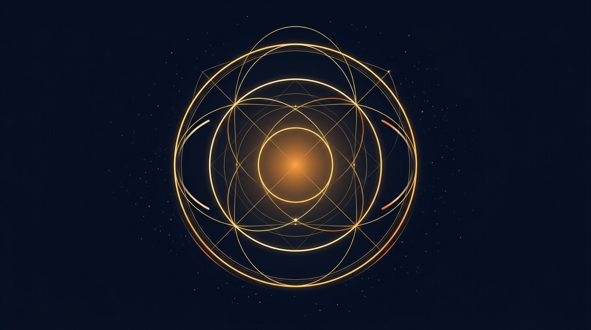
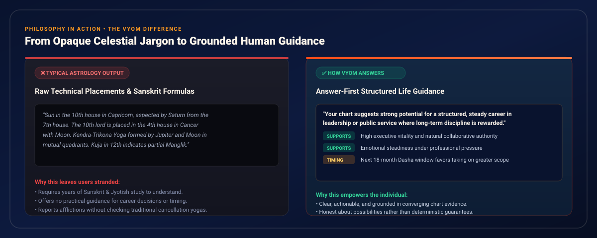
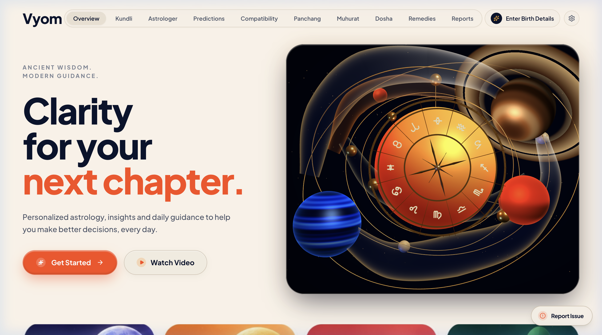
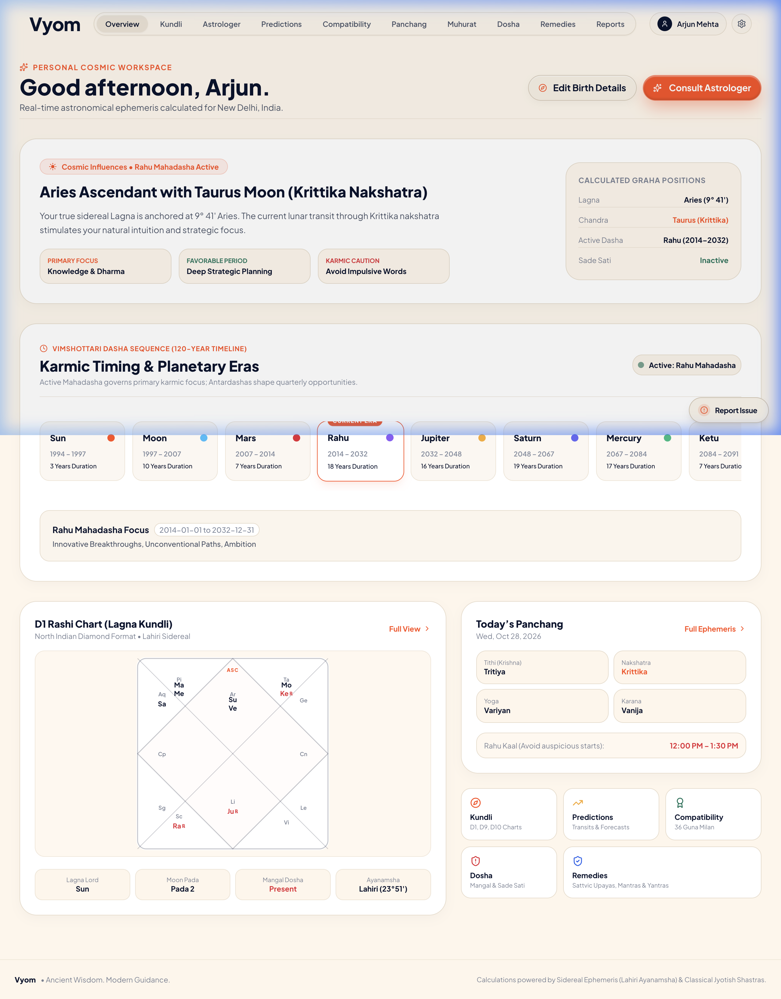
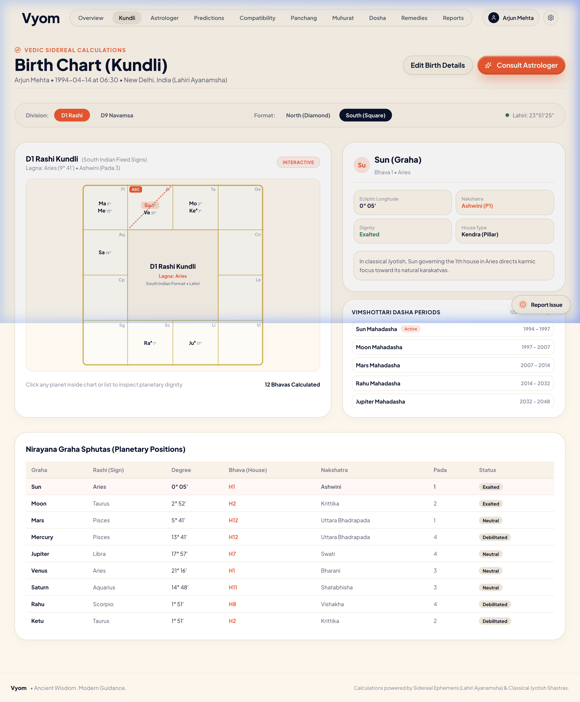
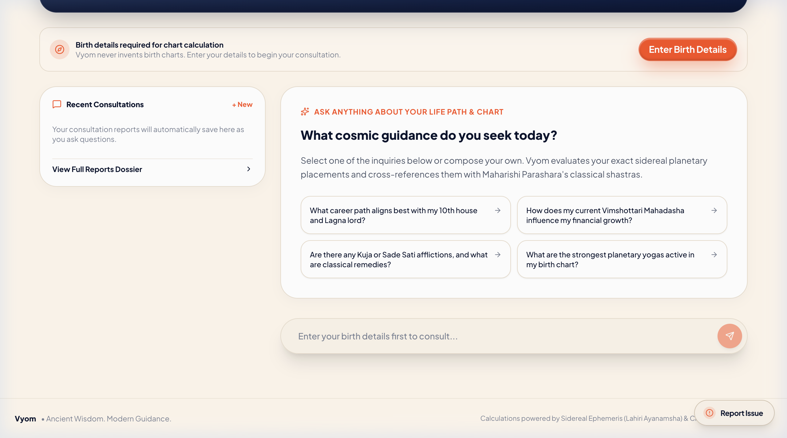
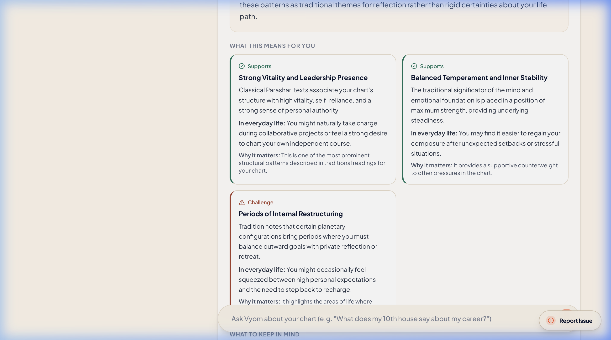
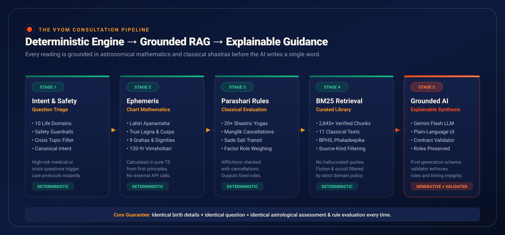
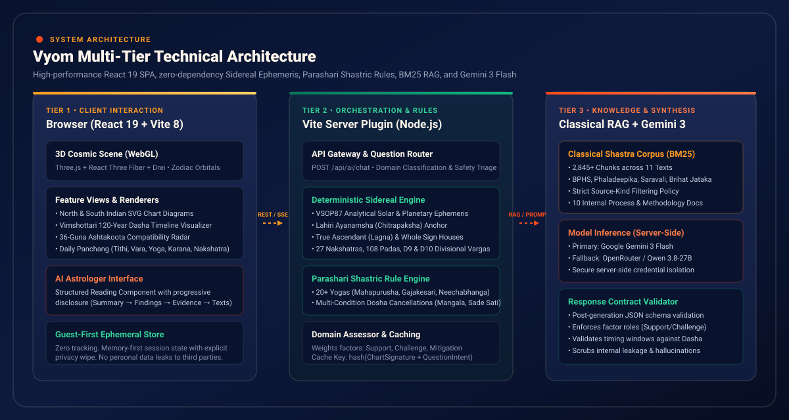
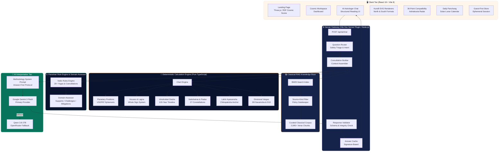

<div align="center">



<br />

# ✦ Vyom

### Clarity for your next chapter.

**Vedic astrology, birth-chart analysis, and AI-assisted interpretation — engineered so anyone can understand what a reading actually means.**

<br />

<p align="center">
  <a href="#-what-is-vyom"><strong>What is Vyom</strong></a> •
  <a href="#-the-vyom-difference"><strong>The Difference</strong></a> •
  <a href="#-the-product"><strong>Product Showcase</strong></a> •
  <a href="#-how-vyom-works"><strong>How It Works</strong></a> •
  <a href="#-features"><strong>Features</strong></a> •
  <a href="#-architecture"><strong>Architecture</strong></a> •
  <a href="#-the-knowledge-base"><strong>Knowledge Base</strong></a> •
  <a href="#-setup"><strong>Setup Guide</strong></a>
</p>

<br />


</div>

<br />

---

<br />

## ✦ What is Vyom?

Vyom is a modern **Vedic astrology (Jyotish) intelligence platform** that combines deterministic astronomical calculations, classical Sanskrit shastras, and grounded AI interpretation. It calculates birth charts with mathematical precision, evaluates traditional rules, retrieves relevant passages from classical scriptures, and uses AI to explain what a reading means in plain, everyday language.

Most astrology applications generate a dense wall of planetary coordinates, Sanskrit yoga names, and contradictory predictions, leaving you to puzzle out what they mean.

Vyom does the opposite: **it delivers an answer to your life question first, supported by transparent reasoning, balanced factors, and classical citations.**

<br />

```
Your Question  ──▶  Deterministic Ephemeris  ──▶  Parashari Rule Engine  ──▶  BM25 Classical RAG  ──▶  Grounded Human Guidance
(e.g. Career)       (VSOP87 + Lahiri Lagna)      (20+ Yogas & Cancellations)   (2,845+ Verse Chunks)    (Validated Plain Language)
```

<br />

---

<br />

## ✦ The Vyom Difference

<div align="center">
  
</div>

<br />

### Why typical astrology tools fail users

<table>
<tr>
<td width="50%">

### ❌ Typical Astrology Output
*Opaque, jargon-dense, ungrounded*

> *"Sun in the 10th house in Capricorn, aspected by Saturn from the 7th house. The 10th lord is placed in the 4th house in Cancer with Moon. Kendra-Trikona Yoga formed by Jupiter and Moon in mutual quadrants. Kuja in 12th indicates partial Manglik."*

- **Requires years of study** to decipher basic meaning
- **Lists placements** without explaining their practical impact
- **Reports afflictions (Doshas)** without checking classical cancellations
- **Generates fear or false hope** through unconditional statements

</td>
<td width="50%">

### ✅ How Vyom Answers
*Answer-first, balanced, actionable*

> *"Your chart suggests strong potential for a structured, steady career — particularly in management, public service, or environments where disciplined long-term planning is rewarded. The next 18 months represent a constructive window to take on more responsibility."*

- **Starts with the answer** to your direct life question
- **Explains what it means for everyday life** in plain language
- **Checks multi-condition cancellations** before reporting any affliction
- **Grounded in classical texts** with verifiable verse citations

</td>
</tr>
</table>

<br />

### How Vyom compares to generic AI astrology chatbots

| Dimension | Generic AI Chatbots | Vyom Platform |
|:----------|:--------------------|:--------------|
| **Planetary Positions** | Hallucinated or guessed by the LLM | Calculated from VSOP87 series in pure TypeScript |
| **Ayanamsha** | Inconsistent or unstated | Strict Lahiri Ayanamsha (Chitrapaksha) anchor |
| **Traditional Rules** | LLM invents or confuses yogas | Evaluated by a 20+ rule Parashari engine with tests |
| **Cancellations** | Often ignores cancellations (causing false alarms) | Every affliction checked against BPHS cancellation criteria |
| **Citations** | Fabricated scripture verses and fake chapters | BM25 retrieval over 2,845+ verified chunks from 11 classical texts |
| **Response Contract** | Unstructured chat text | Validated JSON schema: Factor roles, timing windows, confidence |
| **Consistency** | Different answers every time you ask | **Identical birth data + question = identical analytical conclusions** |

<br />

---

<br />

## ✦ Who is Vyom For?

- **Individuals seeking clarity** who want to explore their birth chart without needing to learn Sanskrit or master complex astrological formulas.
- **Astrology practitioners and students** who value transparent calculation steps, classical verse citations (BPHS, Phaladeepika, Saravali), and verified cancellation conditions.
- **AI and software engineers** interested in production implementations of deterministic domain engines paired with RAG-grounded LLM synthesis and post-generation contract validation.
- **Anyone facing a life decision** — career moves, relationship compatibility, timing of major milestones — who wants a thoughtful, non-sensationalized perspective rooted in a 2,000-year-old interpretive tradition.

<br />

---

<br />

## ✦ The Product

Vyom pairs a rich visual identity ("Cosmic Luxury" — warm cream `#FEF6EB`, midnight navy `#09132E`, solar orange `#FF4B19`, and celestial gold `#FF9A20`) with production-grade engineering.

<br />

### 1. The Cosmic Portal
<div align="center">
  
  <br />
  <em>Interactive 3D cosmic scene rendered client-side via Three.js and React Three Fiber, featuring procedural planetary bodies, orbital rings, and zodiac geometry.</em>
</div>

<br /><br />

### 2. Personal Cosmic Workspace (Dashboard)
<div align="center">
  
  <br />
  <em>Live calculated dashboard for an active profile: Nirayana Lagna, active Mahadasha banner, 120-year Vimshottari timeline with planetary color codes, North Indian Diamond chart, and real-time Panchang.</em>
</div>

<br /><br />

### 3. Interactive Kundli & Planetary Sphutas
<div align="center">
  
  <br />
  <em>High-precision Kundli view with toggleable North (Diamond) and South (Square) Indian formats, D1 Rashi and D9 Navamsha vargas, detailed planetary dignity analysis (Exalted, Debilitated, Moolatrikona), and Nakshatra/Pada boundaries.</em>
</div>

<br /><br />

### 4. Grounded AI Astrologer Consultation
<div align="center">
  
  <br />
  <em>The AI Astrologer inquiry interface: select canonical questions or compose your own. The server-side pipeline verifies birth details and runs the 5-stage synthesis.</em>
</div>

<br /><br />

### 5. Answer-First Structured Reading
<div align="center">
  
  <br />
  <em>The Structured Reading UI: plain-language summary, color-coded supporting and challenging factors, everyday life translations, timing outlooks, and expandable classical citations.</em>
</div>

<br />

---

<br />

## ✦ How Vyom Works

Every consultation in Vyom follows an end-to-end pipeline. The first four stages are **strictly deterministic** — given the same birth data and question, the system produces the exact same chart data, rule evaluations, and retrieved text chunks every single time.

Only the final stage (explaining the verified conclusions in plain language) uses AI.

<br />

<div align="center">
  
</div>

<br />


<br />

### The 5-Stage Breakdown

| Stage | Subsystem | What Happens | Why It Matters |
|:---|:---|:---|:---|
| **1. Intent & Safety Routing** | `questionRouter.ts` | The visitor's question is parsed into one of 10 canonical domains (Career, Relationships, Finances, Health, Spiritual...). Any sensitive, crisis, or medical queries trigger **ethical safety protocols** immediately. | Prevents irresponsible astrological claims on health crises or financial speculation before computation occurs. |
| **2. Deterministic Chart Calculation** | `chartEngine.ts` | The sidereal ephemeris computes true solar, lunar, and planetary longitudes (VSOP87 series), Nirayana Lagna, Whole Sign house cusps, 27 Nakshatras & 108 Padas, and the full 120-year Vimshottari Dasha cycle using the **Lahiri Ayanamsha**. | **Zero external API dependencies**. All coordinates are calculated from first principles in pure TypeScript. |
| **3. Shastric Rule Evaluation** | `vedicRules.ts` | A deterministic rule engine checks 20+ classical Parashari rules: Pancha Mahapurusha Yogas (Ruchaka, Bhadra, Hamsa, Malavya, Shasha), Gajakesari, Neechabhanga Rajayoga, Mangala Dosha (with all classical cancellations), Kala Sarpa, and Sade Sati. | Afflictions are **never reported without evaluating cancellations**. Fixed factor roles (Supporting, Challenging, Mitigating) are locked in. |
| **4. Grounded Knowledge Retrieval** | `bm25.ts` | A fast in-memory BM25 index queries **2,845+ curated verse chunks** from 11 classical and pedagogy texts. A strict domain policy filters chunks so that literary fiction or modern occult texts never masquerade as Vedic authority. | Guarantees that every citation provided to the user is genuine, traceable to a real classical chapter and verse. |
| **5. AI Explanation & Contract Validation** | `aiPlugin.ts` & `responseValidator.ts` | Google Gemini 3 Flash receives the verified chart, evaluated rules, factor roles, and retrieved passages. It writes an everyday-language reading following a strict JSON schema. The **post-generation validator** inspects the output and repairs any unauthorized role shifts or invented timing windows. | The LLM operates purely as an **interpreter and translator**, never as the analytical decision maker. |

<br />

> **The Repeatability Guarantee:**  
> `Chart Signature + Question Intent = Identical Analysis & Rule Assessment`  
> While the AI's phrasing may vary slightly, the underlying factors, timing windows, and confidence ratings cannot deviate.

<br />

---

<br />

## ✦ Features

### Implemented & Verified in Codebase (61/61 Tests Passing)

- **AI Astrologer Chat**: Natural-language chart consultations with structured readings: summary, key findings, supporting/challenging factors, timing windows, technical evidence, and source citations.
- **Pure TypeScript Ephemeris**: Complete sidereal calculation from birth date, time, and coordinates. Computes 9 Grahas (Sun through Ketu), Ascendant (Lagna), 12 Bhava cusps (Whole Sign), and 27 Nakshatras with Padas.
- **Divisional Charts (Vargas)**: Automated calculation of D1 (Rashi), D9 (Navamsha), and D10 (Dashamsha).
- **Interactive SVG Chart Renderers**: Full interactive North Indian (Diamond) and South Indian (Square) chart diagrams with planetary degrees and retrograde indicators.
- **120-Year Vimshottari Dasha Engine**: Complete Mahadasha, Antardasha, and Pratyantardasha timeline calculation from birth Moon Nakshatra balance to 120 years.
- **Parashari Rule Engine**: 20+ classical yogas and doshas evaluated deterministically, including full multi-factor cancellation logic for Manglik and Sade Sati.
- **Classical Knowledge Base (RAG)**: 2,845+ indexed chunks across 11 classical and authoritative texts with BM25 keyword search and source-kind filtering.
- **Domain Assessment Framework**: Per-question analytical engine weighing planetary dignities, houses, and aspects across 10 life domains.
- **Daily Panchang Calculator**: High-precision calculation of Tithi (with Paksha), Nakshatra, Yoga, Karana, Vara, and Rahu Kaal for any location.
- **36-Guna Ashtakoota Compatibility**: Authentic relationship compatibility matching across 8 Kootas (Varna, Vashya, Tara, Yoni, Graha Maitri, Gana, Bhakoot, Nadi) with radar visualization.
- **Dosha Analysis Module**: Detailed breakdown of Mangala Dosha, Kala Sarpa, and Sade Sati with classical cancellation conditions and statistical base-rate context.
- **Muhurat Timing Tool**: Auspicious electional astrology timing finder for major ventures based on solar-lunar angles.
- **Guest-First Privacy Architecture**: No account required. All birth data and chart calculations live in memory/session. Explicit "Clear All Data" wipe.
- **Interactive 3D Cosmic Scene**: Three.js WebGL landing experience with procedural planets, golden orbital ribbons, and zodiac glyphs.
- **Deterministic Response Cache**: Signature-based caching prevents redundant LLM calls and guarantees response consistency.
- **Safety Triage & Guardrails**: Automatic safety intercept for medical queries, self-harm, legal strategy, and financial speculation.

### Planned & Experimental Roadmap

- [ ] Exportable high-resolution PDF consultation reports
- [ ] Visual planetary transit timeline overlay on birth charts
- [ ] Fine-tuning dataset pipeline (`data/training/`) for open-weight models
- [ ] Multi-language support (Hindi, Sanskrit, Tamil, Telugu)
- [ ] Cloud sync for authenticated multi-device chart management

<br />

---

<br />

## ✦ Architecture

Vyom is architected as a clean multi-tier system with complete separation between client interaction, server orchestration, mathematical computation, classical retrieval, and generative explanation.

<br />

<div align="center">
  
</div>

<br />



<br />

### Core Technical Principles

1. **Zero External Astronomical Dependencies**: Planetary orbits and solar positions are computed directly from VSOP87 analytical trigonometric series. No Swiss Ephemeris binaries, no C-bindings, no external REST API calls.
2. **Deterministic Rules, Generative Language**: Mathematical calculations, house placements, planetary dignities, yoga occurrences, and factor role classifications are pure mathematical functions. The LLM's role is restricted to translating verified conclusions into compassionate, plain-language prose.
3. **Strict Source-Kind Filtering**: The knowledge base categorizes every text chunk into one of six taxonomies (Vedic primary, pedagogical commentary, philosophical text, divination compendium, western esoteric, and literary fiction). The retrieval engine enforces strict domain barriers so a novel is never cited as astrological authority.
4. **Post-Generation Response Contract**: The LLM outputs strict JSON validated against `StructuredReading` TypeScript types. A post-processor verifies that factor roles match the deterministic assessment, timing windows align with the Dasha timeline, and confidence ratings are honest.
5. **Absolute Privacy by Design**: All user birth profiles and charts reside in ephemeral session memory. No personal birth records or astrological histories are stored in external databases.

<br />

---

<br />

## ✦ The Knowledge Base

Vyom's interpretations are anchored in a curated library of classical and authoritative texts, segmented into **2,845+ searchable chunks**:

| Classical Text | Author / Translator | Tradition & Role | Chunks |
|:---|:---|:---|---:|
| **Brihat Parashara Hora Shastra** | Maharishi Parashara / R. Santhanam | Classical Vedic Foundation (Primary Authority) | 389 |
| **Brihat Jataka** | Varahamihira / N. Chidambaram Iyer | Classical Vedic Astronomy & Judgement | 330 |
| **Phaladeepika** | Mantreswara / V. Subrahmanya Sastri | Classical Predictive Astrological Shastra | 380 |
| **Saravali** | King Kalyana Varma / R. Santhanam | Classical Comprehensive Shastric Compendium | 315 |
| **Jataka Parijata** | Vaidyanatha Dikshita / V. S. Sastri | Classical Predictive Shastra & Yogas | 246 |
| **Lessons on Vedic Astrology** | P.V.R. Narasimha Rao | Modern Systematic Pedagogy & Calculation Rules | 265 |
| **Origin, Meaning & Purpose of Astrology** | Chennareddy Vasudev | Philosophical Epistemology & Symbolic Analysis | 104 |
| **Practitioner's Compendium** | Traditional Authorities | Practical Divination Reference | 12 |
| **Mysteries of Magic** | Éliphas Lévi / A.E. Waite | Western Esotericism *(Restricted Category)* | 540 |
| **Magic, White and Black** | Dr. Franz Hartmann | Theosophy & Hermeticism *(Restricted Category)* | 383 |
| **Black Magic (novel)** | Marjorie Bowen | Literary Fiction *(Excluded from Astrological Authority)* | 281 |
| **Vyom Internal Process Documents** | Core Engineering Team | 10 Canonical Methodology & Architecture Specs | 10 Docs |

The ingestion pipeline (`scripts/ingest_library.py`) extracts text from original source volumes, segments it into semantically overlapping chunks, scores text quality, and compiles the searchable index at `data/knowledge/curated_corpus.json`.

<br />

---

<br />

## ✦ Project Structure

```
vyom/
├── src/
│   ├── pages/                       # 19 Application routes (Landing, Dashboard, Astrologer, Kundli...)
│   ├── components/
│   │   ├── charts/                  # North & South Indian SVG chart renderers
│   │   ├── vyom/                    # Core UI: StructuredReading, VisualAnswer, BirthDetailsModal
│   │   ├── vyom/cosmic/             # 3D WebGL scene: CosmicCanvas, ZodiacWheel, SaturnRing (R3F)
│   │   ├── visual/                  # DashaTimelineVisualizer, CompatibilityRadar, TransitTimeline
│   │   └── layout/                  # AppShell, Navbar, Sidebar, MobileNav
│   ├── lib/
│   │   ├── astrology/calculations/  # VSOP87 ephemeris, Whole Sign houses, Vimshottari, panchang
│   │   ├── astrology/rules/         # Parashari yogas, doshas, multi-factor cancellations, domain assessor
│   │   ├── knowledge/               # BM25 search index, corpus loaders, source policy filter
│   │   └── storage/                 # Guest-first ephemeral session store
│   ├── server/
│   │   ├── aiPlugin.ts              # Vite server plugin: /api/ai/chat endpoint, Gemini & Qwen adapter
│   │   └── consultation/            # Pipeline: questionRouter, buildConsultation, responseValidator
│   └── types/                       # TypeScript definitions (ChartData, StructuredReading, VisualAnswer)
├── data/
│   ├── knowledge/                   # Searchable curated corpus (2,845+ chunks) and manifests
│   ├── sources/process/             # 10 Vyom canonical process and methodology source documents
│   └── training/                    # Fine-tuning dataset artifacts (experimental)
├── scripts/                         # Corpus ingestion, dataset generation, and verification scripts
├── tests/                           # 61 Automated tests (ephemeris, rules, cancellations, evals)
├── docs/                            # Architecture specs, astrology methodology, and audit reports
└── public/                          # Static assets, WebGL textures, and card artwork
```

<br />

---

<br />

## ✦ Setup

### Prerequisites

- **Node.js** ≥ 20.0.0
- **npm** ≥ 10.0.0
- **Python 3** (only required if running the knowledge-base PDF re-ingestion pipeline)
- A **Gemini API key** from [Google AI Studio](https://aistudio.google.com/) *(Free tier fully supported)*

<br />

### 1. Clone the repository

```bash
git clone https://github.com/arunkumarpatil24j2007-cmd/vyom.git
cd vyom
```

### 2. Install dependencies

```bash
npm install
```

### 3. Configure environment variables

Create your local `.env` configuration file:

```bash
cp .env.example .env
```

Open `.env` and add your Gemini API key:

```env
# AI Model Configuration
PRIMARY_PROVIDER=gemini
GEMINI_API_KEY=your_gemini_api_key_here
GEMINI_MODEL=gemini-3-flash-preview

# Optional OpenRouter Fallback
QWEN_API_KEY=
QWEN_MODEL=qwen/qwen3.8-27b

# Optional Issue Reporting Webhook
GOOGLE_SHEET_WEBHOOK_URL=
```

### 4. Start the development server

```bash
npm run dev
```

Open [http://localhost:5173](http://localhost:5173) in your browser.

<br />

### 5. Run the test suite

Vyom includes 61 automated unit and regression tests covering Meeus astronomical algorithms, Lahiri ayanamsha anchors, yoga evaluations, dosha cancellations, BM25 retrieval, and response validation:

```bash
npm test
```

To run consultation quality and repeatability checks:

```bash
npm run eval           # Consultation quality evaluation
npm run eval:repeat    # Deterministic repeatability verification
```

### 6. Build for production

```bash
npm run build
npm run preview        # Preview production bundle locally
```

<br />

### Environment Variables Reference

| Variable | Required | Default | Description |
|:---|:---:|:---|:---|
| `GEMINI_API_KEY` | **Yes** | — | Google Gemini API key from AI Studio *(free tier supported)* |
| `GEMINI_MODEL` | No | `gemini-3-flash-preview` | Primary Gemini model identifier |
| `GEMINI_BASE_URL` | No | Google AI Studio endpoint | Custom proxy URL for Gemini inference |
| `PRIMARY_PROVIDER` | No | `gemini` | Primary AI provider (`gemini` or `qwen`) |
| `QWEN_API_KEY` | No | — | OpenRouter API key for secondary fallback provider |
| `QWEN_MODEL` | No | `qwen/qwen3.8-27b` | Model identifier for OpenRouter fallback |
| `GOOGLE_SHEET_WEBHOOK_URL` | No | — | Optional Google Apps Script webhook for issue reporting |

<br />

---

<br />

## ✦ Responsible Use & Ethical Guardrails

Vedic astrology is an ancient symbolic and interpretive tradition with profound cultural and philosophical significance. Vyom is built on a philosophy of intellectual discipline and ethical responsibility:

- **Traditional Interpretive Framework, Not Deterministic Science**: Controlled empirical studies have not demonstrated that planetary positions predict life events above statistical chance. Vyom presents the teachings of the classical shastras with fidelity and respect, but does not claim scientific proof.
- **Dependency on Birth Data Precision**: Astrological calculations depend on accurate birth coordinates and timing. An unknown or approximate birth time limits Lagna-dependent analysis. Vyom is transparent about data precision and informs the user rather than speculating.
- **Possibilities, Not Guarantees**: Vyom uses nuanced, responsible language ("your chart suggests," "classical tradition associates," "a constructive period to explore"). It strictly prohibits fatalistic pronouncements, fixed calamity dates, or guaranteed windfalls.
- **Clear Ethical Boundaries**: Vyom's safety router intercepts medical queries, psychological emergencies, legal strategies, pregnancy predictions, and financial speculation. It redirects these inquiries to professional care resources.
- **Base-Rate Transparency**: Common planetary configurations are presented with statistical honesty. For example, Gajakesari Yoga occurs in approximately 33% of charts, and Mars occupies a "Manglik" house in 40–50% of charts. Vyom explains these placements with standard context rather than exaggerating their rarity.

<br />

---

<br />

## ✦ Tech Stack

| Layer | Technologies |
|:---|:---|
| **Frontend Framework** | React 19, TypeScript 6, Vite 8, React Router 7 |
| **Styling & Design System** | Tailwind CSS 4, Custom CSS Design Tokens ("Cosmic Luxury") |
| **3D Graphics & Canvas** | Three.js, React Three Fiber (R3F), `@react-three/drei` |
| **Data Visualizations** | Recharts, Custom Responsive SVG Engines |
| **Iconography** | Lucide React |
| **Astrology Calculations** | Pure TypeScript Sidereal Ephemeris (VSOP87, Lahiri Ayanamsha, Whole Sign) |
| **Rule & Domain Engine** | Parashari Shastric Rules, Multi-Condition Cancellation Logic |
| **Knowledge Base (RAG)** | In-Memory BM25 Index, Curated 2,845+ Chunk Corpus |
| **AI Inference** | Google Gemini 3 Flash *(Primary)*, OpenRouter Qwen 3.8-27B *(Fallback)* |
| **Testing & Quality** | Node.js Built-In Test Runner (61 Tests), OxLint |

<br />

---

<br />

## ✦ Contributing

Contributions from astrologers, developers, and designers are welcome. High-priority areas:

- **Ephemeris Precision**: Refinements to planetary perturbation terms for outer planets.
- **Classical Text OCR**: Improving OCR and verse segmentation for historical translations.
- **Transit Visualizer**: Enhancing the interactive transit timeline component.
- **Rule Verification**: Writing additional test cases for complex yoga cancellation conditions.
- **Accessibility & Internationalization**: Expanding keyboard navigation and multi-language translations.

Please read our contribution standards and open an issue before submitting significant architectural changes.

<br />

---

<br />

## ✦ License & Intellectual Property

This project is currently provided for evaluation and personal exploration. All rights are reserved. Classical texts cited within the knowledge base belong to their respective historical traditions and scholarly translators.

<br />

---

<br />

## ✦ Acknowledgments

Vyom's knowledge retrieval and calculation engine stand on the shoulders of the classical Vedic astrological tradition and the scholarly translators who preserved these works:
- **Maharishi Parashara** (*Brihat Parashara Hora Shastra*, trans. R. Santhanam)
- **Varahamihira** (*Brihat Jataka*, trans. N. Chidambaram Iyer)
- **Mantreswara** (*Phaladeepika*, trans. V. Subrahmanya Sastri)
- **King Kalyana Varma** (*Saravali*, trans. R. Santhanam)
- **Vaidyanatha Dikshita** (*Jataka Parijata*, trans. V. Subrahmanya Sastri)
- **P.V.R. Narasimha Rao** (*Lessons on Vedic Astrology*)
- **Chennareddy Vasudev** (*Origin, Meaning and Purpose of Astrology*)

<br />

<div align="center">

---

**Vyom** — *from the Sanskrit व्योम (vyoman): sky, ether, space, the infinite heavens.*

*The space between the stars is where meaning lives.*

<br />

<sub>Crafted with care by <a href="https://github.com/arunkumarpatil24j2007-cmd">Arunkumar Patil</a></sub>

</div>
