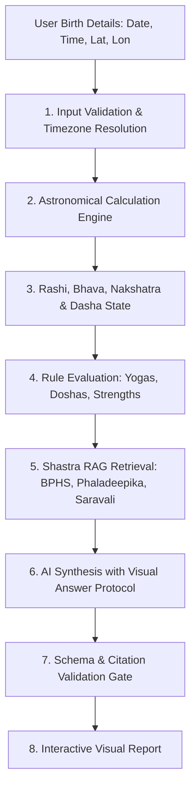

# Vyom Astrology Methodology & Astronomical Calculation Standards

*Document Version:* 2.0.0  
*Updated:* 2026-10-19  
*System Architect:* Vyom Astronomical Systems & Shastric Knowledge Engineering Team  
*Target Engine:* Sidereal Nirayana Engine (System B) & Classical Knowledge Base (System A)  

---

## 1. Astronomical Foundation: Sidereal Nirayana Zodiac & Ayanamsha

### 1.1 Tropical vs. Sidereal
Western astrology relies on the Tropical (Sayana) zodiac, which ties $0^\circ$ Aries to the vernal equinox. Due to the axial precession of the Earth (~$50.29''$ arc per Julian year), the vernal equinox slowly drifts westward against the background of fixed stellar constellations.
Vedic astrology strictly employs the **Sidereal (Nirayana) Zodiac**, which anchors $0^\circ$ Aries to fixed stellar coordinates.

### 1.2 Lahiri (Chitra Paksha) Ayanamsha
- **Reference Standard:** Official Government of India Calendar Reform Committee (Saha Commission, 1952) and Indian Astronomical Ephemeris standard.
- **Anchor:** The fixed star Chitra (Spica / $\alpha$ Virginis) is fixed at precisely $180^\circ 00' 00''$ (diametrically opposite $0^\circ$ Mesha / Aries).
- **Epoch Coordinate:** At epoch J2000.0 ($2000\text{ Jan }1.5\text{ TT}$, Julian Day $2451545.0$):
  $$\text{Ayanamsha}_{J2000} = 23^\circ 51' 25.53''$$
- **Precession Rate:** $50.290966''$ per Julian year.
- **Continuous Ayanamsha Equation:**
  $$T = \frac{\text{JD} - 2451545.0}{36525.0}$$
  $$\text{Ayanamsha}(T) = 23.85709167^\circ + 1.396971278^\circ \cdot T - 0.0003086^\circ \cdot T^2$$

---

## 2. Mathematical Time, Coordinates & Ascendant (Lagna)

1. **Julian Day ($\text{JD}$):** Calculated directly from Gregorian calendar birth date and UTC decimal hour.
2. **Greenwich Mean Sidereal Time ($\text{GMST}$):**
   $$\text{GMST}_0 = 280.46061837^\circ + 360.98564736629^\circ \cdot (\text{JD} - 2451545.0) + 0.000387933^\circ \cdot T^2$$
3. **Local Sidereal Time ($\text{LST}$):**
   $$\text{LST} = (\text{GMST} + \text{Geographic Longitude}) \pmod{360^\circ}$$
4. **Ascendant ($\text{Lagna}$) Computation:**
   $$\tan(\lambda_{\text{Asc, Tropical}}) = \frac{-\cos(\text{LST})}{\sin(\text{LST})\cos(\varepsilon) + \tan(\phi)\sin(\varepsilon)}$$
   Where $\varepsilon$ is the true obliquity of the ecliptic ($23.4392911^\circ - 0.0130042^\circ \cdot T$) and $\phi$ is the geographic latitude.
5. **Nirayana Lagna (Sidereal Ascendant):**
   $$\lambda_{\text{Lagna, Sidereal}} = (\lambda_{\text{Asc, Tropical}} - \text{Ayanamsha}) \pmod{360^\circ}$$
6. **Bhava System:** Whole Sign House system (*Rashi Bhava*) as mandated by Maharishi Parashara in *Brihat Parashara Hora Shastra*, cross-verified with Sripati/Chalit cusps for sandhi evaluations.

---

## 3. The 27 Nakshatras and 108 Padas

The $360^\circ$ sidereal ecliptic is divided into 27 equal Nakshatras of $13^\circ 20' (13.333333^\circ)$ each:
$$\text{Nakshatra Index} = \left\lfloor \frac{\lambda_{\text{Moon}}}{13^\circ 20'} \right\rfloor$$
Each Nakshatra is subdivided into 4 Padas of $3^\circ 20' (3.333333^\circ)$ each (totaling 108 Padas across the 12 signs), forming the exact mathematical bridge to the **Navamsha (D-9)** chart:
$$\text{Navamsha Sign Index} = \left\lfloor \frac{\lambda_{\text{Planet}}}{3^\circ 20'} \right\rfloor \pmod{12}$$

---

## 4. Vimshottari Dasha Engine (120-Year Cycle)

- **Primary Shastra Reference:** *Brihat Parashara Hora Shastra*, Ch. 46 (*Dasha Phala Adhyaya*).
- **Planetary Cycle & Allocated Solar Years:**
  - Ketu: 7 years
  - Shukra (Venus): 20 years
  - Surya (Sun): 6 years
  - Chandra (Moon): 10 years
  - Mangala (Mars): 7 years
  - Rahu: 18 years
  - Guru (Jupiter): 16 years
  - Shani (Saturn): 19 years
  - Budha (Mercury): 17 years
  - **Total Cycle:** Exactly 120 solar years ($43,830$ solar days).
- **Balance of Dasha at Birth:**
  $$\text{Elapsed Fraction} = \frac{\lambda_{\text{Moon}} \pmod{13^\circ 20'}}{13^\circ 20'}$$
  $$\text{Remaining Dasha Years} = \text{Lord Years} \cdot (1 - \text{Elapsed Fraction})$$
- **Antardasha (Sub-Period) Computation:**
  $$\text{Antardasha Duration (Years)} = \frac{\text{Mahadasha Years} \times \text{Antardasha Lord Years}}{120}$$

---

## 5. Classical Rules & Dosha Evaluation

### 5.1 Mangal (Kuja) Dosha & Classical Cancellations (*BPHS*, Ch. 81)
- **Primary Rule:** Mars situated in the 1st, 4th, 7th, 8th, or 12th house from Lagna, Chandra, or Shukra.
- **Classical Cancellations (*Bhanga*):**
  1. Mars in own sign (*Mesha* or *Vrishchika*) or exalted in *Makara*.
  2. Jupiter occupies a Kendra or directly aspects Mars.
  3. Mars situated in Leo (*Simha*) or Aquarius (*Kumbha*).
  4. Mutual Kuja placement: Both prospective partners possess Kuja Dosha in similar houses.
  5. Mars placed in the 8th house in Jupiter's signs (*Dhanus* or *Meena*).

### 5.2 Shani Sade Sati (*Saravali*, Ch. 31; *Phaladeepika*, Ch. 26)
- **Transit Rule:** Saturn transiting through the 12th, 1st, and 2nd houses relative to the natal Moon sign.
  - **Phase 1 (Rising / Aadhya):** Saturn in 12th from Moon (~2.5 years). Psychological restructuring.
  - **Phase 2 (Peak / Madhya):** Saturn conjunct natal Moon sign (~2.5 years). Core karmic crucible.
  - **Phase 3 (Setting / Antya):** Saturn in 2nd from Moon (~2.5 years). Material and financial realignment.

### 5.3 Kaal Sarp Yoga (*Jataka Parijata*, Ch. 8)
- **Definition:** All seven physical celestial bodies (Surya through Shani) hemmed between the Rahu-Ketu nodal axis with no planetary escape.
- **Partial/Anshik Cancellation:** Any planet conjoining either node or breaking the hemisphere breaks the complete enclosure.

---

## 6. Panchang Mathematical Formulations

- **Tithi:** Lunar phase calculated from the longitudinal angular separation between Moon and Sun:
  $$\text{Tithi Number} = \left\lfloor \frac{(\lambda_{\text{Moon}} - \lambda_{\text{Sun}}) \pmod{360^\circ}}{12^\circ} \right\rfloor + 1$$
- **Nitya Yoga:** Angular sum of Nirayana solar and lunar longitudes:
  $$\text{Yoga Number} = \left\lfloor \frac{(\lambda_{\text{Moon}} + \lambda_{\text{Sun}}) \pmod{360^\circ}}{13^\circ 20'} \right\rfloor + 1$$
- **Karana:** Half-Tithi span ($6^\circ$). Exactly 60 Karanas per lunar month.
- **Rahu Kaal:** Daytime divided into 8 equal segments; assigned according to weekday lord sequence (Mon: 2nd segment, Sat: 3rd segment, Fri: 4th, Wed: 5th, Thu: 6th, Tue: 7th, Sun: 8th).

---

## 7. The Six Deterministic Astrology Workflows

Every astrological interpretation in Vyom follows a strictly defined workflow pipeline:

### Workflow 1: Kundli & Horoscope Generation
- **Required Inputs:** Date of Birth, Local Time of Birth (HH:mm:ss), Geographic Latitude & Longitude, Timezone Offset.
- **Calculation Dependencies:** Julian Day, GMST, LST, Obliquity, Lahiri Ayanamsha, Tropical-to-Sidereal reduction, Whole Sign House mapping.
- **Applicable Shastras:** *BPHS* Ch. 3–14; *Brihat Jataka* Ch. 1–3.
- **Expected Output:** D-1 (Rashi Chart), D-9 (Navamsha Chart), Planetary coordinates table with Nakshatra/Pada, Lagna point, current Mahadasha/Antardasha.
- **Validation:** Ascendant must match exact geographical horizon; longitudes between $0^\circ$ and $360^\circ$.

### Workflow 2: Vimshottari Dasha Progression & Prediction
- **Required Inputs:** Natal Moon longitude, Current target date.
- **Calculation Dependencies:** Moon Nakshatra elapsed fraction, starting balance of Dasha, cumulative year addition.
- **Applicable Shastras:** *BPHS* Ch. 46–50; *Phaladeepika* Ch. 19–22.
- **Expected Output:** Multi-tier timeline (Mahadasha, Antardasha, Pratyantardasha) with start and end dates, ruling lords, and transit overlaps.

### Workflow 3: Planetary Transits (Gochara) & Sade Sati
- **Required Inputs:** Natal Moon sign, Natal Lagna, Ephemeris date.
- **Calculation Dependencies:** Real-time planetary positions for current date, relative house offsets from natal Moon.
- **Applicable Shastras:** *Phaladeepika* Ch. 26; *Saravali* Ch. 31.
- **Expected Output:** Current transit overlay, Sade Sati phase detection, Jupiter 5/7/9 protective aspects, Ashtakavarga bindu counts.

### Workflow 4: Kundli Milan (Ashtakoota Compatibility)
- **Required Inputs:** Groom (Partner 1) & Bride (Partner 2) Moon Nakshatra and Pada.
- **Calculation Dependencies:** The 8 Kootas: Varna (1 pt), Vashya (2 pts), Tara (3 pts), Yoni (4 pts), Graha Maitri (5 pts), Gana (6 pts), Bhakoot (7 pts), Nadi (8 pts). Total = 36 points.
- **Applicable Shastras:** *BPHS* Ch. 81; *Jataka Parijata* Ch. 12.
- **Expected Output:** Detailed koota breakdown, score out of 36, Nadi Dosha / Bhakoot Dosha exception checks, spiritual synthesis.

### Workflow 5: Daily Panchang & Muhurat Detection
- **Required Inputs:** Calendar Date, Observer Latitude & Longitude.
- **Calculation Dependencies:** Solar sunrise, sunset, exact Sun-Moon longitudinal difference.
- **Applicable Shastras:** *Muhurta Chintamani*; *BPHS* Ch. 5.
- **Expected Output:** Tithi, Nakshatra, Yoga, Karana, Rahu Kaal, Abhijit Muhurat, Gulika Kaal, Choghadiya.

### Workflow 6: Dosha Diagnosis & Remedial Counseling
- **Required Inputs:** Natal chart planetary positions.
- **Calculation Dependencies:** Mangal Dosha check with 5 cancellations; Sade Sati phase; Kaal Sarp check; Kemadruma Yoga check.
- **Applicable Shastras:** *BPHS* Ch. 10 & 81; *Phaladeepika* Ch. 6.
- **Expected Output:** Dosha status (Active, Mild, Fully Cancelled), cancellation rationale, satvik remedial recommendations (Mantras, Yantras, Dhyana, ethical conduct).

---

## 8. Shastric Harmonization Principles

When classical authorities present divergent rules:
1. **Primary Authority Hierarchy:** *Brihat Parashara Hora Shastra* takes precedence as the primary root authority (*Mula Shastra*).
2. **Predictive Specificity:** *Phaladeepika* (Mantreswara) and *Saravali* (Kalyana Varma) are consulted for fine-grained transit and conjunction nuances.
3. **Transparent Divergence:** Where Parashari and Jaimini or Varahamihira methods offer distinct analytical vantage points (e.g. Vimshottari vs. Chara Dasha), the system explicitly labels the school of interpretation rather than conflating them.
