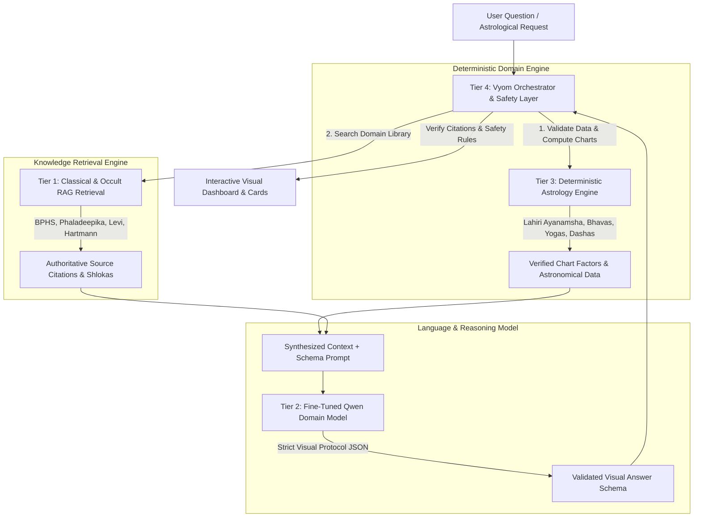

# Vyom AI Fine-Tuning Feasibility Investigation & Execution Plan

*Document Version:* 1.0.0  
*Updated:* 2026-10-19  
*System Architect:* Vyom AI/ML & LLM Systems Engineering Team  
*Target Model Lineage:* Qwen 2.5 / Qwen 3.x Family (Open-Weight & API-Hosted)  

---

## 1. Investigation of Currently Configured Model & Provider

### 1.1 Current Configuration Audit
In the existing Vyom application (`src/server/aiPlugin.ts` and `.env`):
- **Provider Base URL:** `https://openrouter.ai/api/v1` (OpenRouter API)
- **Model Identifier:** `qwen/qwen3.8-27b` (or `qwen/qwen-2.5-72b-instruct` / `qwen/qwen-2.5-32b-instruct`)
- **Protocol:** Standard OpenAI-compatible Chat Completions endpoint with JSON schema output (`response_format: { type: "json_object" }`).

### 1.2 Fine-Tuning Feasibility on Current Provider (OpenRouter)
- **Can OpenRouter fine-tune models?**
  **NO.** OpenRouter is strictly an **inference router and API aggregator**. It hosts zero training infrastructure and provides no fine-tuning endpoints (such as `POST /v1/fine_tuning/jobs`).
- **Can an externally fine-tuned model be hosted on OpenRouter?**
  **NO.** OpenRouter does not allow users to upload custom LoRA adapters or weights for private hosting.
- **Provider Conclusion:** The currently configured provider endpoint **cannot** be used to run fine-tuning jobs.

---

## 2. Technical Feasibility of Fine-Tuning Qwen Models

The Qwen model family (released by Alibaba Cloud / Qwen Team) consists of state-of-the-art open-weight models (`Qwen2.5-7B`, `Qwen2.5-14B`, `Qwen2.5-32B`, `Qwen2.5-72B`). Because the weights are publicly licensed (Apache 2.0 / Qwen Open License), **domain-specific fine-tuning is 100% technically feasible** through dedicated training and fine-tuning platforms.

### 2.1 Model Selection for Domain Adaptation

| Base Model | Architecture | Active Parameters | Context Window | Recommended Fine-Tuning Method | Min VRAM Required (Training) | Deployment VRAM (Inference) |
|:---|:---|:---|:---|:---|:---|:---|
| **Qwen2.5-7B-Instruct** | Dense Transformer | 7.6B | 128k (native) | Full / LoRA / QLoRA | 1x RTX 4090 (24GB) or A10G (24GB) | 16GB (FP16) or 6GB (4-bit) |
| **Qwen2.5-14B-Instruct** | Dense Transformer | 14.7B | 128k (native) | QLoRA / LoRA | 1x A100 (40GB/80GB) | 28GB (FP16) or 10GB (4-bit) |
| **Qwen2.5-32B-Instruct** *(Recommended)* | Dense Transformer | 32.5B | 128k (native) | QLoRA (Rank 64, Alpha 128) | 1x A100 (80GB) or 2x A100 (40GB) | 64GB (FP16) or 20GB (4-bit) |
| **Qwen2.5-72B-Instruct** | Dense Transformer | 72.7B | 128k (native) | QLoRA | 2x-4x A100 (80GB) or 1x H100 (80GB) | 144GB (FP16) or 44GB (4-bit) |

*Recommendation:* **Qwen2.5-32B-Instruct** provides the optimal balance of reasoning depth (capable of complex multi-factor astrological synthesis, Sanskrit terminology handling, and strict JSON adherence) while fitting comfortably on a single 80GB GPU during QLoRA training.

---

## 3. Four Concrete Execution Paths & Cost Analysis

Before committing any budget or switching architectures, here are the four viable deployment paths:

### Path A: Hybrid Architecture (Recommended for Immediate Production)
- **Inference Provider:** Retain OpenRouter / hosted Qwen (`qwen/qwen3.8-27b` or `qwen/qwen-2.5-32b-instruct`).
- **Knowledge Base:** Client-side & server-side RAG ingestion of all 9 books (2,603 pages) with semantic and lexical retrieval.
- **Astrology Engine:** Deterministic Swiss Ephemeris / Lahiri Ayanamsha calculator for all mathematical facts.
- **Visual Answer Protocol:** Enforced JSON schema with strict validation.
- **Estimated Cost:** **$0 infrastructure overhead** (only per-token inference: ~$0.0004 per 1k tokens, ~$5–$15/month for typical development usage).
- **Advantage:** Zero deployment maintenance, zero cold starts, immediate production readiness.

### Path B: Managed Serverless Fine-Tuning (Together AI / Fireworks AI)
- **Training Method:** Upload JSONL training pairs to Together AI or Fireworks.
- **Base Model:** `Qwen/Qwen2.5-32B-Instruct` or `Qwen2.5-14B-Instruct`.
- **Training Cost:** ~$15 to $45 per training run (1,000–5,000 high-quality instruction examples).
- **Hosting Cost:** Serverless LoRA adapter inference (~$0.80 per million tokens) or dedicated endpoint (~$1.50/hour = ~$1,080/month if run 24/7).
- **Provider Impact:** Switch `QWEN_BASE_URL` in `.env` to `https://api.together.xyz/v1`.

### Path C: Self-Hosted Cloud Training & Inference (RunPod / Modal / Lambda Labs)
- **Training:** Rent a 1x NVIDIA A100 (80GB SXM4) on RunPod for 3–5 hours running Unsloth / Axolotl.
  - Compute cost: $1.89/hr × 4 hours = **~$7.56 per training run**.
- **Inference:**
  - Export merged GGUF or AWQ weights.
  - Deploy to RunPod Serverless vLLM worker (scales to zero when idle).
  - Cost: ~$0.0006/second of active execution (~$10–$25/month).

### Path D: Local Apple Silicon Inference (Mac M-Series with 32GB+ Unified Memory)
- **Base Model:** `Qwen2.5-14B-Instruct-GGUF` or `Qwen2.5-32B-Instruct-Q4_K_M`.
- **Engine:** Ollama / llama.cpp running natively on macOS.
- **Cost:** **$0 external spend.**
- **Provider Impact:** Set `QWEN_BASE_URL=http://localhost:11434/v1` and `QWEN_MODEL=qwen2.5:14b`.

---

## 4. The 4-Tier Architectural Separation

To guarantee mathematical truth and prevent hallucinations, Vyom strictly separates knowledge acquisition, mathematical calculation, model adaptation, and runtime orchestration:



1. **Tier 1 (Knowledge Retrieval / RAG):** Contains the actual contents of the 9 books. Provides exact page numbers, book titles, translations, and commentaries. The LLM does *not* need to memorize 2,603 pages; it retrieves them on demand.
2. **Tier 2 (Fine-Tuned / Domain-Aligned Model):** Aligned on tone, Sanskrit vocabulary, refusal to hallucinate missing data, strict adherence to the Visual Answer Protocol, and comparative synthesis.
3. **Tier 3 (Deterministic Engine):** Calculates planetary longitudes, Rashis, Bhavas, Nakshatras, Vimshottari Dashas, and classical dosha cancellations using documented mathematics. The LLM is strictly prohibited from guessing degrees or planetary placements.
4. **Tier 4 (Orchestration & Validation):** Ingests user input, executes Tier 3, retrieves Tier 1, invokes Tier 2, validates the resulting JSON against Zod/TypeScript schemas, verifies citation authenticity, and renders rich UI components.

---

## 5. Curated Training Dataset Architecture

Raw books cannot be fed directly as training tokens for an instruction model. Instead, source material is converted into structured instruction-response pairs covering 13 distinct pedagogical categories:

### 5.1 Dataset Taxonomy & Target Distribution (1,000 Curated Examples)

1. **Astrology Terminology Explanations (10%):** Sanskrit karakatvas, planetary dignities, avasthas, divisional charts.
2. **Source-Grounded Question Answering (15%):** Answering specific queries citing chapter and shloka numbers.
3. **Identification of Relevant Chart Factors (10%):** Mapping a life domain (e.g. 10th house career) to primary lords, karakas, and aspects.
4. **Selection of Correct Analysis Workflow (10%):** Step-by-step diagnostic workflows (Kundli -> Lagna -> Moon -> Dasha -> Gochara).
5. **Interpretation of Documented Astrological Rules (10%):** Applying specific rules from BPHS or Phaladeepika.
6. **Comparison of Different Traditional Interpretations (8%):** Contrasting Parashari vs. Jaimini or Saravali variants.
7. **Explanation of Classical Analogies (5%):** Illuminating metaphors (e.g. Sun as King, Moon as Queen, Mars as Commander).
8. **Distinction Between Source Claims & Verified Calculations (8%):** Explaining where astronomical math ends and interpretive guidance begins.
9. **Handling Incomplete Information (6%):** Graceful request for missing birth time or exact coordinates.
10. **Correct Citation Formatting (6%):** Strict adherence to `title`, `author`, `chapter`, `shloka`, `excerpt`.
11. **Refusal to Fabricate Missing Data (5%):** Strict refusal when a chart factor or source passage is unavailable.
12. **Historical vs. Empirical Distinction in Occult Traditions (7%):** Contextualizing ritual practices and symbols without endorsing superstition.

### 5.2 Training Data Format (ShareGPT / OpenAI Chat Format)

```json
{
  "messages": [
    {
      "role": "system",
      "content": "You are Vyom's Vedic Astrologer, a master Jyotish scholar and precision astrological counselor..."
    },
    {
      "role": "user",
      "content": "My natal Moon is in Taurus at 14 degrees and Jupiter is in Leo at 18 degrees. Do I have Gaja Kesari Yoga, and what does Phaladeepika say about its manifestation?"
    },
    {
      "role": "assistant",
      "content": "{\n  \"summary\": \"Yes, your chart forms an authentic Gaja Kesari Yoga with Moon in Taurus and Jupiter in the 4th house from Moon in Leo.\",\n  \"category\": \"spiritual\",\n  \"blocks\": [\n    {\n      \"type\": \"metric\",\n      \"label\": \"Yoga Formation\",\n      \"value\": \"Gaja Kesari Yoga\",\n      \"explanation\": \"Jupiter is placed in the 4th Kendra from the radical Moon.\"\n    },\n    {\n      \"type\": \"source\",\n      \"title\": \"Phaladeepika\",\n      \"author\": \"Mantreswara\",\n      \"chapter\": \"Yoga Adhyaya (Ch. 6)\",\n      \"shloka\": \"Shloka 14\",\n      \"excerpt\": \"When Jupiter occupies a Kendra from the Moon, the native is endowed with enduring renown, ethical leadership, and steadfast wisdom.\"\n    }\n  ],\n  \"followUpQuestions\": [\n    \"What are the current Dasha influences on this yoga?\",\n    \"How does Jupiter's aspect on the 10th and 12th houses modify the result?\"\n  ],\n  \"disclaimer\": \"Calculated using Sidereal Zodiac (Lahiri Ayanamsha).\"\n}"
    }
  ]
}
```

---

## 6. Training & Evaluation Procedure

1. **Establish Baseline:** Benchmark the current hosted Qwen endpoint on a fixed 100-question evaluation set (`data/evaluation/benchmark_eval_v1.json`). Measure:
   - Schema adherence (% valid JSON).
   - Citation accuracy (% matching verified books).
   - Hallucination rate (% fabricated calculations).
   - Tone & terminology compliance.
2. **Generate Training Corpus:** Run `scripts/generate_finetune_dataset.py` to synthesize and curate instruction-response pairs grounded in the 9 books.
3. **Curate & Filter:** Deduplicate, remove ambiguous responses, and validate against the Zod schema.
4. **LoRA Fine-Tuning Pilot:** Fine-tune `Qwen2.5-14B` or `Qwen2.5-32B` with rank $r=32$, $\alpha=64$, target modules `q_proj, k_proj, v_proj, o_proj, gate_proj, up_proj, down_proj`.
5. **Post-Training Evaluation:** Run the identical 100-question benchmark. Verify that domain accuracy increases without regressing general reasoning.
6. **Deployment Gate:** Deploy custom weights only if fine-tuning demonstrably outperforms prompt-engineered RAG on citation fidelity and visual schema consistency.
