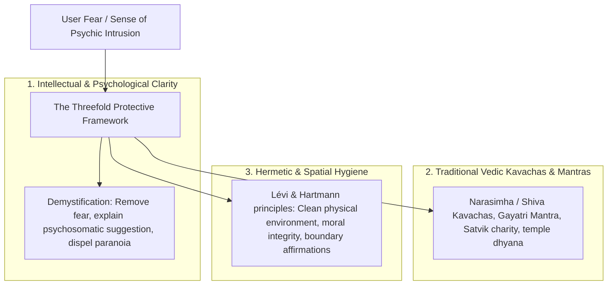

# Vyom Occult Traditions, Esoteric Knowledge & Protection Methodology

*Document Version:* 1.0.0  
*Updated:* 2026-10-19  
*System Architect:* Vyom Esoteric Systems & Comparative Occult Philosophy Team  
*Target Engine:* Dedicated Black Magic & Occult Traditions Knowledge System  

---

## 1. Philosophical & Scholarly Foundation

The **Black Magic & Occult Traditions** knowledge module in Vyom provides an authoritative, historically grounded, and psychologically mature exposition of Western Hermeticism, Kabbalah, ceremonial magic, traditional folklore, and Eastern esoteric protection traditions. 

The primary literary anchors for this module are:
1. ***The Mysteries of Magic: A Digest of the Writings of Éliphas Lévi*** (Alphonse Louis Constant, edited by Arthur Edward Waite, 1886).
2. ***Magic, White and Black: Or The Science of Finite and Infinite Life*** (Dr. Franz Hartmann, M.D., 1888/1890).
3. ***Classical Vedic Protective Traditions*** (*Brihat Parashara Hora Shastra*, *Atharva Veda* hymns, *Kavachas*, and *Mantra Shastra*).

### 1.1 The Definition of "Magic" in the Classical Sources
As defined by Éliphas Lévi and Dr. Franz Hartmann:
- **True (White) Magic:** The conscious alignment of human will and imagination with universal divine order (*Dharma*, *Logos*, *Universal Harmony*). It is the art of spiritual self-mastery, purification, and psychological equilibrium.
- **Sorcery / Black Magic (*Goetia* / *Abhichara*):** The perversion of will and mental power toward selfish subjugation, exploitation, malice, or illusion. The classical masters unanimously identify black magic not as a triumphant supernatural dominion, but as a degenerative psychological and energetic pathology rooted in delusion and destructive ego-obsession.

---

## 2. Six-Tier Epistemological Taxonomy

To prevent sensationalism, superstition, and fear-mongering, every concept, practice, and text excerpt in the knowledge system is categorized into one of six distinct epistemological layers:

| Layer ID | Classification Layer | Definition & Treatment in Vyom |
|:---|:---|:---|
| **EPI-1** | **Historical Descriptions** | Objective historical accounts of how beliefs, grimoires, trials, and occult movements emerged in Renaissance Europe, Victorian occult revivals, and ancient Vedic civilizations. Treated as cultural history. |
| **EPI-2** | **Religious & Cultural Beliefs** | Traditional community beliefs, scriptural narratives, folklore, and devotional understandings of spirits, planetary deities (*Grahas*), and protective powers. Presented with cultural reverence and sociological neutrality. |
| **EPI-3** | **Traditional Ritual Frameworks** | Documented sequences of symbolic actions, geometry (circles, pentagrams, yantras), invocations, incense, and timing (lunar phases, planetary hours). Coded strictly as traditional ritual art. |
| **EPI-4** | **Esoteric & Symbolic Interpretations** | Deep psychological and philosophical translations of occult symbolism (e.g., the Astral Light as collective subconscious; demons as unintegrated neuroses and repressed passions; the Philosopher's Stone as spiritual rebirth). |
| **EPI-5** | **Modern Psychological Syntheses** | Modern analytical frameworks (Jungian archetypes, cognitive behavioral parallels to psychic hygiene, psychosomatic impacts of fear and belief). |
| **EPI-6** | **Unsupported / Disputed Claims** | Claims of physical levitation, literal blood pacts, deterministic harm at a distance, or infallible hexes. **Strictly flagged as folklore, metaphorical allegories, or unverified claims.** |

---

## 3. The Core Esoteric Concepts (System Architecture)

### 3.1 The Astral Light (*L'Agent Magique / Universal Medium*)
- **Source:** Éliphas Lévi, *Mysteries of Magic*, Part II.
- **Classical Concept:** The subtle electromagnetic/vital medium that permeates nature, reflecting thoughts, emotions, and symbolic forms.
- **Analytical Interpretation:** The universal substrate of shared consciousness and emotional contagion. Lévi emphasizes that an untrained mind is buffeted by astral currents, while a disciplined, purified will acts as a sovereign mirror that repels low-vibrational intrusions.

### 3.2 The Nature of "Bewitchment" (*Envoûtement*) and Curses
- **Source:** Lévi, Part VI, Ch. II; Hartmann, Ch. 5.
- **Deconstruction:**
  1. True bewitchment operates almost entirely through **psychological suggestion, fear, and shared belief**. When an individual fears a curse, their own subconscious mind manifests anxiety, insomnia, psychosomatic distress, and self-fulfilling misfortune.
  2. The antidote documented by Lévi is absolute fearlessness, moral integrity, and intellectual clarity: *"To be invulnerable to bewitchment, one must be pure, calm, and void of superstitious dread. The arrow falls powerless against the diamond of the true initiate."*

### 3.3 The Pentagram and Geometric Equilibrium
- **Source:** Lévi, Part III (*The Mysteries of the Pentagram*).
- **Symbolism:** The upright five-pointed star represents the spirit governing the four physical elements (earth, air, fire, water). Inverted, it represents the animal impulses subjugating reason. The symbol is an instrument of self-remembrance and psychological boundary enforcement, not a magic charm.

---

## 4. Protection & Traditional Remedies (Psychic Hygiene)

Where classical texts document protective measures, Vyom organizes them under **Psychic Hygiene & Traditional Spiritual Safeguards**:

### 4.1 Traditional Protective Practices in the Corpus
1. **The Vedic Kavach (Armor):**
   - *Source:* *Brihat Parashara Hora Shastra*, Ch. 10; *Narada Purana*.
   - *Application:* Recitation of divine protective verses (e.g. *Durga Saptashati*, *Maha Mrityunjaya*, *Narasimha Kavacha*) to instill serene surrender and invoke transcendent order over anxiety.
2. **Hermetic Banishing & The Pentagram of Light:**
   - *Source:* Lévi, Part III; Hartmann, Ch. 8.
   - *Application:* Visualization of solar clarity, affirming personal sovereignty, and mentally expelling intrusive negative thoughts.
3. **Environmental Hygiene:**
   - *Application:* Use of natural fumigants (camphor, guggulu, sandalwood, frankincense), clean living spaces, and natural light to clear stagnation.

---

## 5. Strict Safe Implementation Boundaries & Red Lines

The Black Magic & Occult Traditions module in Vyom operates under strict ethical rules:

### 5.1 ABSOLUTE PROHIBITIONS
1. **Facilitating Real-World Harm:**
   - No instructions for preparing poisons, chemical mixtures, narcotics, or physical substances.
   - No rituals designed or intended to stalk, harass, coerce, manipulate, or inflict bodily injury on another person.
   - Any query attempting to harm another person triggers an immediate safe refusal emphasizing the classical law of karmic rebound (*lex talionis* as described by Lévi and Hartmann).
2. **Fear-Mongering & Exploitation:**
   - The AI must **NEVER** tell a user: *"You are cursed,"* *"A black magic ritual has been placed on you,"* or *"An enemy or family member has placed evil eye on you."*
   - The AI must **NEVER** claim to detect possession, hexes, or paranormal targeting.
   - The AI must dismantle fear by explaining the classical psychological understanding of superstitious suggestion.
3. **No Commercial Occult Quackery:**
   - The system does not sell, endorse, or promote "curse removal spells," paid exorcisms, or occult fixers.
4. **Mandatory Citations:**
   - Every ritual description or historical claim must cite the specific book (*The Mysteries of Magic*, *Magic, White and Black*, or *BPHS*), chapter, and page number.
   - The system will never fabricate occult manuscripts or make unsubstantiated claims.

---

## 6. Tone & Aesthetic Guidelines

- **Scholarly & Contemplative:** Elegant, dignified, historically rigorous, and philosophical.
- **Aesthetic:** Warm cream, deep midnight navy, celestial gold, rich cinnabar red accents, fine geometric engravings, and illuminated manuscript styling.
- **Tone:** Resolute, calm, clarifying, and demystifying — never gothic, hysterical, morbid, or sensationalized.
